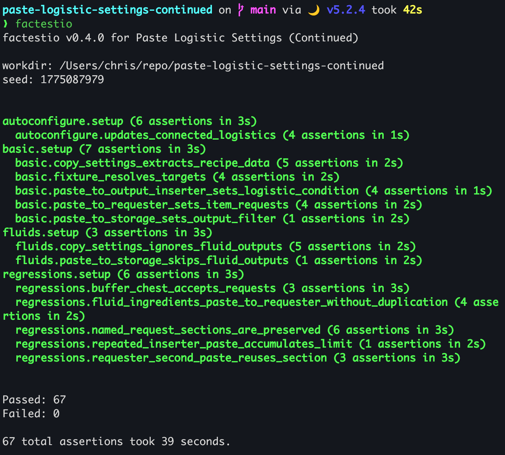

# factestio
A [Scenario Tree Testing] framework for Factorio mods. Define tests as a DAG —
child tests inherit their parent's full world state via save/restore snapshots,
letting you build up complex game states incrementally.

> **Platform support:** macOS is the primary platform. Linux bootstrap and path
> detection are best-effort for common installs.

## Requirements
- Factorio (headless)
- Lua 5.2.x on PATH (Factorio's runtime is Lua 5.2; other versions are not
  supported)
- LuaRocks
- bash

Lua 5.2 is not available via Homebrew core. The recommended approach is
[luaver](https://github.com/DhavalKapil/luaver):

```bash
luaver install 5.2.4 && luaver use 5.2.4
```

Or compile from source, or use your system package manager if it provides 5.2.x.

## Installation
```bash
brew install cmtonkinson/tap/factestio
luarocks install --deps-only factestio-*.rockspec
```

## Setup
From your mod project directory, run `factestio activate`. It:
1. Creates `factestio/` in your mod project, with `config.lua` (from
   `config.lua.example`) and `example.lua` as a starting point
2. Adds `config.lua` to `factestio/.gitignore` and `factestio_results/` to the
   project root `.gitignore`
3. Symlinks your project's `factestio/` into the factestio scenario, and the
   factestio repo and your mod into Factorio's mods directory
4. Enables both mods in `mod-list.json` and, unless `--keep-other-mods` is
   given, disables all other non-base mods

Then edit `factestio/config.lua`:

```lua
return {
  os_paths = {
    binary = '/Applications/factorio.app/Contents/MacOS/factorio',
    data = '/Users/<you>/Library/Application Support/factorio',
  }
}
```

On Linux, common defaults are:

```lua
return {
  os_paths = {
    binary = '/home/<you>/.factorio/bin/x64/factorio',
    data = '/home/<you>/.factorio',
  }
}
```

`factestio activate` also checks `FACTESTIO_FACTORIO_BINARY` and
`FACTESTIO_FACTORIO_DATA` before falling back to platform defaults.

`factestio deactivate` removes the links and restores the `mod-list.json`
captured when activation began.

## CLI
| Flag | Description |
|------|-------------|
| `-h, --help` | Show command help |
| `-V, --version` | Print the installed factestio version |

### Test run
```bash
factestio [options] [mod_dir]
```

| Flag | Description |
|------|-------------|
| `-d, --debug` | Run in debug mode |
| `--leaf ID` | Run only the named scenario and its parent chain |
| `--branch ID` | Run the named scenario, its parents, and all children |
| `--seed N` | Seed Lua `math.random` for reproducible test runs |
| `-t, --timeout N` | Timeout for each scenario in seconds (default: 8) |

`ID` is the fully-qualified scenario id, e.g. `my_tests.setup`. Without
`--seed`, factestio generates a seed and prints it so the run can be
reproduced.

### `doctor`
`factestio doctor` validates the Lua 5.2, LuaRocks, and Factorio setup.

### `activate` / `on`
```bash
factestio activate [mod_dir]
```

| Flag | Description |
|------|-------------|
| `--keep-other-mods` | Keep other non-base mods enabled during activation |
| `-q, --quiet` | Suppress informational output |

### `deactivate` / `off`
```bash
factestio deactivate [mod_dir]
```

| Flag | Description |
|------|-------------|
| `-q, --quiet` | Suppress informational output |

### `list`
Shows the compiled scenario DAG without running Factorio.

```bash
factestio list [options] [mod_dir]
```

| Flag | Description |
|------|-------------|
| `--roots` | Show only root scenarios |
| `--children ID` | Show the named scenario and all descendants |
| `--json` | Emit machine-readable JSON (combines with either mode) |

## Writing tests
Every `factestio/*.lua` file except `config.lua` is discovered automatically
and returns a table of named scenarios. Results of the latest run go to
`factestio_results/` in the project root.

```lua
-- factestio/my_tests.lua
return {
  -- Root test: starts from a fresh world
  setup = {
    test = function(f, context)
      local surface = context.game.surfaces[1]
      surface.create_entity({ name = "assembling-machine-2", position = {x=1, y=1} })
      f:expect(1, 1)
    end,
  },

  -- Child test: inherits setup's world state (assembler is present)
  verify_entity = {
    from = 'setup',
    test = function(f, context)
      local surface = context.game.surfaces[1]
      local found = surface.find_entities({{0,0},{2,2}})
      f:expect(#found, 1)
      f:expect(found[1].name, "assembling-machine-2")
    end,
  },
}
```

| Key | Type | Description |
|-----|------|-------------|
| `test` | `function(f, context)` | Required. Main test body. |
| `from` | `string` | Parent test name. Child starts from parent's saved world state. |
| `before` | `function(f, context)` | Runs before `test`. |
| `after` | `function(f, context)` | Runs after `test`, even if `test` fails. |

Scenarios are registered as `<file>.<name>`. A bare `from` (`'setup'`) refers to
the same file; a dotted one (`'other_file.setup'`) is absolute.

### Assertions
```lua
f:expect(actual, expected)   -- assert actual == expected
```

### Player settings
`f:with_player_settings` overrides runtime player settings for one callback:

```lua
f:with_player_settings(player, {
  ["my-mod-request-size-type"] = "items",
  ["my-mod-request-size"] = 7,
}, function(current_player)
  -- settings.get_player_settings(current_player.index) returns the merged
  -- overrides here.
end)
```

Values may be raw or `{ value = ... }` tables. The original `settings` table is
restored even if the callback raises.

### Context
```lua
context.game     -- LuaGameScript
context.player   -- nil in headless (no player)
context.event    -- the on_tick event
context.node     -- the test node (metadata)
```

## How it works
Each test runs in a fresh headless Factorio process:

- **Root tests** (no `from`) launch with `--start-server-load-scenario`,
  generating a fresh world.
- **Child tests** load the parent's save zip with `--start-server`, restoring
  the full world state.

At tick +10 the test runs, at +20 the world is saved, at +30 the process
signals completion. Saves and logs are collected under `factestio_results/`.
A failed test skips its children.

## Sample project
[cmtonkinson/paste-logistic-settings-continued] uses factestio. Sample output:



[cmtonkinson/paste-logistic-settings-continued]:
https://github.com/cmtonkinson/paste-logistic-settings-continued
[Scenario Tree Testing]: https://medium.com/@chris_59795/you-write-too-many-tests-6ce58e959045
